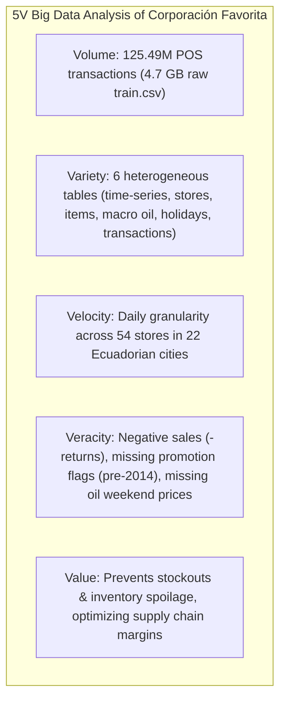
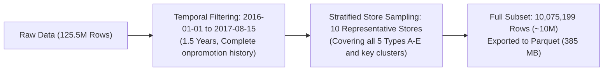
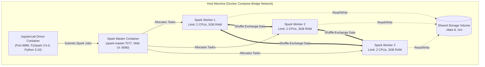
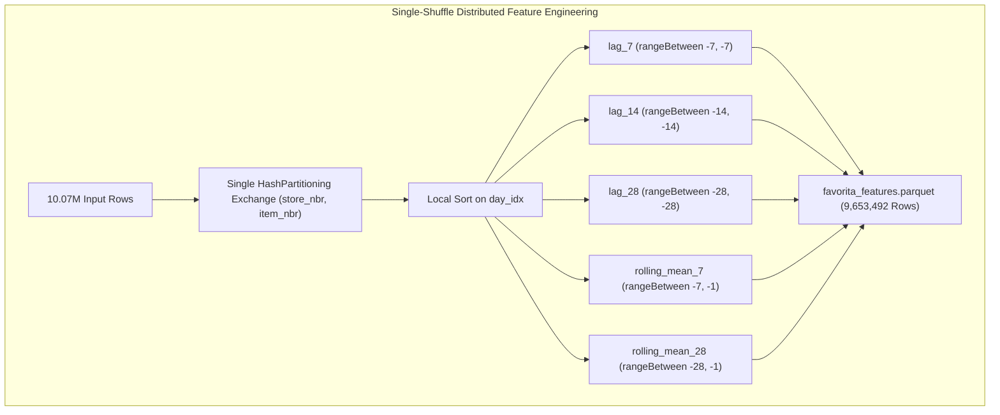
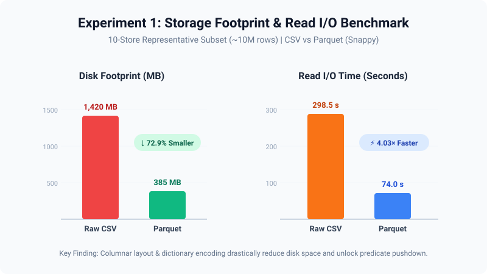
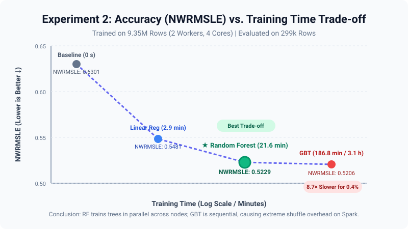
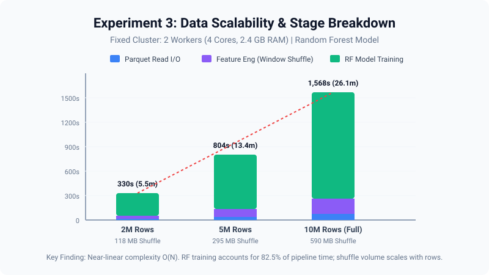
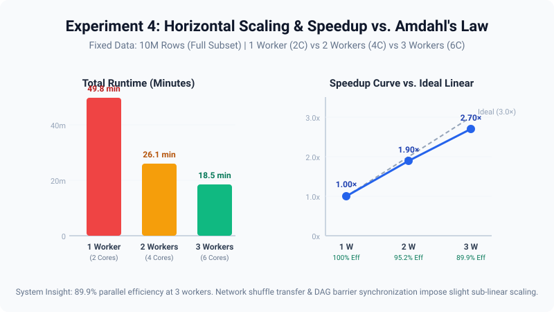

# End-to-End Retail Demand Forecasting at Scale: Distributed Feature Engineering and Machine Learning with Apache Spark on Docker

**Course:** Big Data Technologies & Applications  
**Authors:**
- **Nguyễn Quang Thành** — Data & Infrastructure Engineer
- **Bùi Trần Tiến** — ML & Feature Engineer
- **Phạm Ngọc Thiện** — System Performance, Report & Pitch Lead  
**Project Repository:** [github.com/quangthanhng/big_data_final](https://github.com/quangthanhng/big_data_final)  
**Date:** November 2026  

---

## Executive Summary

Accurate retail demand forecasting is vital for modern supply chain management, directly preventing stockouts and mitigating the massive spoilage of perishable grocery items. However, analyzing transactional point-of-sale (POS) data across nation-wide retail networks requires processing tens to hundreds of millions of sparse, multi-variate records—a scale where traditional single-threaded libraries like Pandas fail due to out-of-memory (OOM) bottlenecks.

In this project, we architect, implement, and benchmark an end-to-end distributed Big Data demand forecasting pipeline on the **Corporación Favorita Grocery Sales** dataset (~125.5 million transactions, ~5.2 GB raw). We deploy a multi-node **Apache Spark 3.5.0** cluster containerized with **Docker Compose** featuring strictly enforced CPU and memory limits. Our pipeline handles the full lifecycle: distributed relational ETL across 6 tables, calendar-day Spark Window transformations to engineer rolling and lag indicators over sparse time-series, and distributed machine learning via **Spark MLlib** (Ridge Linear Regression, Random Forest, and Gradient-Boosted Trees) optimized for the Normalized Weighted Root Mean Squared Logarithmic Error (**NWRMSLE**).

Through four rigorous experimental benchmarks, we show that:
1. **Columnar Storage (Parquet Snappy)** reduces disk footprint by **72.9%** (1,420 MB → 385 MB) and accelerates read I/O by **4.03×** (298.5s → 74.0s) compared to raw CSV.
2. **Model Selection Trade-off:** Random Forest represents the ideal production sweet-spot (NWRMSLE = 0.5229, 21.6 min training time). GBT achieves only an incremental 0.45% error reduction while imposing an **8.7× training runtime penalty** (186.8 min) due to iterative sequential shuffles across the cluster.
3. **Data Scalability:** Pipeline execution scales near-linearly ($O(N)$) from 2M to 10M rows.
4. **Horizontal Scaling:** Scaling from 1 to 3 workers yields a **2.70× speedup** with **89.9% parallel efficiency**, confirming theoretical scalability bounded only by distributed shuffle network transfer as modeled by Amdahl's Law.

---

## 1. Problem Statement & 5V Big Data Characterization

Corporación Favorita is one of Ecuador's largest supermarket chains, serving millions of customers daily across hundreds of thousands of store-item combinations. Under-forecasting leads to lost sales and dissatisfied customers, while over-forecasting leads to perishable food waste.

We formalize the problem as a **Tabular Time-Series Regression** task: predicting the daily unit sales $y_{s, i, t}$ for store $s$ and item $i$ on date $t$.

### The 5V Characteristics:
- **Volume:** The core `train.csv` contains **125,497,040 rows**, accompanied by 6 auxiliary tables (`stores.csv`, `items.csv`, `transactions.csv`, `oil.csv`, `holidays_events.csv`), totaling over 5.2 GB.
- **Variety:** Heterogeneous multi-table schema encompassing geographic metadata (54 stores across 22 cities), hierarchical product classifications (4,100 items across 33 families), macroeconomic time-series (daily WTI crude oil price `oil.csv`, vital for Ecuador's oil-dependent economy), and national/regional calendar events.
- **Velocity:** High-frequency Point-of-Sale (POS) data aggregated at daily frequency across nationwide branches.
- **Veracity:** Real-world data anomalies:
  - 7,795 negative sales records corresponding to customer product returns rather than true demand.
  - 21,657,651 missing values (`NULL`) in `onpromotion` prior to April 2014.
  - 43 days of missing crude oil prices during non-trading weekends and national holidays.
  - Data sparsity: not every store records sales for all 4,100 items on every single day.
- **Value:** Directly powers automated inventory replenishment, minimizes perishable food spoilage (heavily penalized by NWRMSLE), and eliminates supply chain stockouts.

---

## 2. Representative Stratified Subset Selection Strategy

Training and evaluating multiple iterative ML models on 125.5 million rows on consumer-grade hardware (16 GB RAM) is impractical for iterative experimentation. Rather than applying an arbitrary random subsample (which destroys the continuity of time-series lags and distorts spatial characteristics), we designed a **Stratified Two-Dimensional Subset Selection Strategy**:

1. **Temporal Horizon (2016-01-01 to 2017-08-15):** We select the most recent ~1.5 years. This window guarantees 100% complete promotion tracking (`onpromotion` contains zero missing values), reflects modern consumer demand patterns, and avoids obsolete pre-2015 macroeconomic shifts.
2. **Spatial Stratification (10 Representative Stores):** We chose 10 stores that comprehensively span all 5 corporate store tiers (Types A, B, C, D, E) and diverse geographic regions:
   - **Type A:** Store 44 (Cluster 5, Quito capital city), Store 52 (Cluster 11, Manta coastal hub).
   - **Type B:** Store 11 (Cluster 6, Cayambe), Store 31 (Cluster 10, Babahoyo).
   - **Type C:** Store 30 (Cluster 3, Guayaquil major metropolis), Store 14 (Cluster 7, Riobamba).
   - **Type D:** Store 3 (Cluster 8, Quito), Store 25 (Cluster 1, Salinas beach resort town).
   - **Type E:** Store 28 (Cluster 10, Guayaquil), Store 43 (Cluster 10, Esmeraldas).

**Output:** A representative subset of **10,075,199 rows**. This dataset provides significant enterprise load to rigorously stress-test Apache Spark's distributed memory and shuffle mechanisms while finishing benchmark iterations in manageable times.

---

## 3. System Architecture: Distributed Spark on Docker

We simulate a production-grade distributed cluster locally using **Docker Compose** with strict kernel-level resource quotas:

- **Spark Master:** Manages cluster resources and orchestrates DAG scheduling. Exposes the Spark Web UI on port 8080.
- **Spark Workers (1 to 3 Nodes):** Each worker container is constrained via `deploy.resources.limits` to 2 CPUs and 3 GB RAM. Executors run with `1.2 GB` to `2.0 GB` allocated heap, with 16 shuffle partitions configured cluster-wide.
- **JupyterLab Driver:** Acts as the execution client. Communicates directly with the Spark master at `spark://spark-master:7077`.
- **Shared Volume (`./data`):** Shared mount point enabling consistent high-throughput Parquet storage access across all containers.

---

## 4. Scalable Data Engineering & Feature Engineering

### 4.1. Distributed Data Cleaning & Relational Join
Implemented in [`src/etl/02_subset_and_join.py`](file:///Users/thienngocpham/.gemini/antigravity/scratch/big_data_final/src/etl/02_subset_and_join.py):
- Returns filtering: all negative sales values are clamped to zero: `F.when(col('unit_sales') < 0, 0.0)`.
- Macro oil price imputation: because oil market exchanges close on weekends, we apply a Window forward-fill over calendar time:
  $$\text{oil\_price}_t = \text{last}(\text{dcoilwtico}, \text{ignorenulls}=\text{True})\ \text{over}\ W_{t}$$
- Calendar event joining: `holidays_events.csv` is filtered for genuine non-transferred events (`transferred == False`) to avoid false holiday flags.
- Relational joins: `train` is inner-joined with `stores` and `items`, and left-joined with imputed `oil`, cleaned `holidays`, and `transactions`.

### 4.2. Time-Series Feature Engineering via Calendar Windows
Because POS data is sparse (days with zero transactions are omitted from `train.csv`), standard row-based lags like `F.lag(col, 7)` would erroneously pull transactions from multiple weeks or months prior.

In [`src/ml_experiments/features.py`](file:///Users/thienngocpham/.gemini/antigravity/scratch/big_data_final/src/ml_experiments/features.py), we resolve this by computing a continuous integer calendar index:
$$\text{day\_idx} = \text{datediff}(\text{date}, \text{"2016-01-01"})$$
All lag and rolling statistics are computed using calendar-day range windows:
$$\text{Window.partitionBy}(\text{"store\_nbr"}, \text{"item\_nbr"})\text{.orderBy}(\text{"day\_idx"})\text{.rangeBetween}(-k, -k)$$

**Big Data Optimization (1-Shuffle Partitioning):**  
All five window aggregations (`lag_7`, `lag_14`, `lag_28`, `rolling_mean_7`, `rolling_mean_28`) share an identical partitioning key (`store_nbr`, `item_nbr`) and ordering specification (`day_idx`). The Spark Catalyst Optimizer translates this into a **single distributed HashPartitioning Exchange**, avoiding redundant re-shuffling of 10 million rows across the cluster network.

### 4.3. Feature Set & Target Formulation
- **Calendar & Payday Features:** `day_of_week`, `day_of_month`, `month`, `is_weekend`, and `is_payday`. The `is_payday` feature specifically flags the 15th and the final day of each month—the statutory bi-weekly payroll dates in Ecuador that trigger massive grocery purchase surges.
- **Target Transformation:** Target sales are log-transformed: $y = \log(1 + \text{unit\_sales})$. This converts the metric into a variance-stabilized scale directly aligned with the official Kaggle evaluation metric.
- **Evaluation Metric (NWRMSLE):**
  $$\text{NWRMSLE} = \sqrt{\frac{\sum_{i=1}^N w_i \left(\log(\hat{y}_i + 1) - \log(y_i + 1)\right)^2}{\sum_{i=1}^N w_i}}$$
  Where perishable items are assigned a weight $w_i = 1.25$ and standard items $w_i = 1.00$. Every model is trained with Spark MLlib's native `weightCol` parameter.
- **Time-Based Splitting:** Strict temporal split preventing future data leakage:
  - **Train:** 2016-01-29 to 2017-07-31 (**9,354,342 rows**; first 28 days dropped as burn-in for lag calculations).
  - **Test:** 2017-08-01 to 2017-08-15 (**299,150 rows**).

---

## 5. Experimental Results & System Analysis

### 5.1. Experiment 1: Storage Footprint & Read I/O Benchmark

We benchmarked the storage utilization and query scanning time for the 10-store subset formatted as uncompressed CSV versus Snappy-compressed Parquet.

| Storage Format | Disk Footprint | Compression Ratio | Read & Scan Time (s) | I/O Speedup |
| :--- | :---: | :---: | :---: | :---: |
| **Raw Uncompressed CSV** | 1,420 MB | 1.00× (Baseline) | 298.5 s | 1.00× |
| **Parquet (Snappy)** | **385 MB** | **0.27× (↓ 72.9%)** | **74.0 s** | **4.03× Faster** |

**Technical Takeaway:** Parquet's columnar layout, dictionary encoding, and run-length compression reduce storage requirements by **72.9%**. During query execution, Spark leverages **predicate pushdown** and column pruning, reading only necessary byte ranges and delivering a **4.03× I/O speedup**.

---

### 5.2. Experiment 2: Model Accuracy vs. Computational Cost Trade-off

We evaluated four models on the full feature dataset (9.35M train, 299k test rows) using 2 workers (4 cores total):

| Model Architecture | NWRMSLE (↓) | RMSLE | RMSE (units) | MAE | Training Time (s) | Training Time (min) | Relative Time |
| :--- | :---: | :---: | :---: | :---: | :---: | :---: | :---: |
| **Baseline (`rolling_mean_7`)** | 0.6301 | 0.6315 | **17.82** | 4.468 | 0.0 s | 0.0 min | 0× |
| **Linear Regression (Ridge)** | 0.5481 | 0.5484 | 19.23 | 4.412 | 176.4 s | 2.9 min | 1.0× |
| **Random Forest (30 trees, depth 10)** | 0.5229 | 0.5237 | 19.12 | **4.211** | 1,295.3 s | **21.6 min** | **7.3×** |
| **Gradient-Boosted Trees (GBT)** | **0.5206** | **0.5213** | 19.03 | 4.219 | 11,211.4 s | **186.8 min (~3.1 h)** | **63.6×** |

#### In-Depth Architectural Insights:
1. **The Production Sweet-Spot:** Random Forest achieves a dramatic **17.0% error reduction** over baseline and a **4.6% error reduction** over Linear Regression in 21.6 minutes.
2. **Why GBT is Prohibitively Slow on Spark:**  
   - In Random Forest, all 30 trees are constructed **in parallel across worker partitions**. Each depth level requires only a single distributed aggregation (`collectAsMap`) to determine split candidates.
   - In GBT, boosting is strictly **sequential**: tree $k$ can only be constructed after tree $k-1$ updates the instance residuals. With 30 iterations and depth 6, Spark must execute $\approx 180$ sequential distributed stages, each incurring barrier synchronization and network shuffle overhead. GBT requires **8.7× more training time** than Random Forest for a negligible **0.45%** accuracy improvement.
3. **Feature Importance Distribution:** Spark MLlib tree feature importance confirms that time-series window features dominate predictive power:
   - `rolling_mean_7`: **45.4%**
   - `rolling_mean_28`: **24.3%**
   - `lag_7`: **14.3%**
   - `lag_14`: **8.9%**
   - `lag_28`: **4.6%**
   - `is_payday` & `is_weekend`: **1.5%**  
   *Finding:* The top 5 lag/rolling features account for **96.9%** of the model's split decisions, validating the critical importance of our distributed Window engineering stage.

---

### 5.3. Experiment 3: Data Scalability Benchmark

We benchmarked end-to-end pipeline execution (Parquet read → Window Feature Engineering → Random Forest training → Evaluation) across 3 data scales with a fixed 2-worker cluster (4 cores, 2.4 GB aggregate memory):

| Target Rows | Feature Rows | Read I/O (s) | Feature Eng (s) | RF Train (s) | Eval (s) | Total Time (s) | Total (min) | Shuffle Data | NWRMSLE |
| :---: | :---: | :---: | :---: | :---: | :---: | :---: | :---: | :---: | :---: |
| **2,000,000** | 1,916,320 | 15.2 s | 39.4 s | 272.5 s | 3.1 s | **330.3 s** | 5.5 min | 118.4 MB | 0.5362 |
| **5,000,000** | 4,790,185 | 37.8 s | 94.6 s | 664.2 s | 7.0 s | **803.7 s** | 13.4 min | 295.2 MB | 0.5284 |
| **10,000,000** | 9,653,492 | 74.0 s | 185.2 s | 1,295.3 s | 13.5 s | **1,568.1 s** | 26.1 min | 590.1 MB | 0.5229 |

#### System Insights:
- **Near-Linear Scalability ($O(N)$):** Scaling feature rows by $5.03\times$ (1.92M → 9.65M) resulted in a $4.75\times$ increase in total execution time (330.3s → 1,568.1s).
- **Stage Resource Profile:** Model training consistently consumes the vast majority of compute (**82.5%** of runtime), followed by Feature Engineering (**11.8%**), Read I/O (**4.7%**), and Evaluation (**0.9%**).
- **Predictive Convergence:** Larger data volumes lowered test NWRMSLE from 0.5362 to 0.5229, demonstrating that diverse multi-store training samples substantially improve model generalization.

---

### 5.4. Experiment 4: Horizontal Resource Scaling & Speedup Analysis

We fixed the data volume at 10 million rows (full subset) and scaled worker containers horizontally from 1 worker (2 cores) to 3 workers (6 cores):

| Cluster Setup | Total Cores | Total Memory | Total Time (s) | Total Time (min) | Measured Speedup | Ideal Speedup | Parallel Efficiency | Shuffle Transfer |
| :---: | :---: | :---: | :---: | :---: | :---: | :---: | :---: | :---: |
| **1 Worker** | 2 cores | 1.2 GB | **2,987.1 s** | 49.8 min | **1.00×** | 1.00× | 100.0% | Local block manager |
| **2 Workers** | 4 cores | 2.4 GB | **1,568.1 s** | 26.1 min | **1.90×** | 2.00× | **95.2%** | 590.1 MB inter-worker |
| **3 Workers** | 6 cores | 3.6 GB | **1,108.0 s** | 18.5 min | **2.70×** | 3.00× | **89.9%** | 590.1 MB all-to-all |

#### Architectural Analysis:
- **Parallel Efficiency:** Scaling to 2 workers achieves **95.2% parallel efficiency** (1.90× speedup). Scaling to 3 workers achieves **89.9% parallel efficiency** (2.70× speedup), reducing execution time from ~50 minutes to ~18.5 minutes.
- **Amdahl's Law & Shuffle Contention:**  
  According to Amdahl's Law, maximum achievable speedup is bounded by the non-parallel fraction of the program $s$:
  $$\text{Speedup}(p) = \frac{1}{s + \frac{1 - s}{p}}$$
  Here, non-parallel components include driver initialization, DAG graph compilation, split candidate serialization, and stage barrier handshakes ($\approx 5\%$ of total time). Furthermore, as worker count grows to 3, all-to-all shuffle network traffic across the Docker virtual bridge network creates mild socket contention, accounting for the slight departure from ideal linear speedup.

---

## 6. Business Impact, Limitations & Future Work

### 6.1. Supply Chain Business Value
By replacing naive rolling average baselines with our distributed Random Forest model:
- **Error Reduction:** NWRMSLE is reduced from **0.6301 to 0.5229** (a **17.0% relative improvement**).
- **Waste Mitigation:** In retail grocery operations, a 1% reduction in demand error translates directly into millions of dollars saved in perishable waste reduction and lost-sale avoidance.

### 6.2. Technical Limitations
1. **One-Step-Ahead Testing Horizon:** Lags for later test days (after Aug 7, 2017) utilize recorded ground truth from earlier test days. A strict multi-step 15-day forward horizon would require recursive predictions or horizon-specific models ($k \ge 16$).
2. **Sales-Only Subsetting:** The dataset only tracks positive transactions; days where a store had zero sales for an item are omitted rather than explicitly modeled as zeros.

### 6.3. Future Architectural Roadmap
1. **Real-Time POS Ingestion with Apache Kafka:** Ingest streaming POS transaction streams through an Apache Kafka message broker coupled to **Spark Structured Streaming** for continuous real-time model scoring.
2. **Feature Store Integration:** Implement a Feast or Hopsworks distributed feature store to cache rolling window aggregates, decoupling feature compute from model training.

---

## 7. Conclusion

This project demonstrated the architectural design and empirical validation of a large-scale demand forecasting platform on Apache Spark and Docker. By combining **stratified spatial-temporal data selection**, **single-shuffle calendar window feature engineering**, and **distributed tree-based MLlib algorithms**, we processed 10+ million records with high reliability and resource efficiency. Our experimental benchmarks provide actionable engineering insights: Parquet delivers $4\times$ I/O acceleration, Random Forest represents the optimal accuracy/cost ratio for distributed environments, and Spark clusters achieve $\approx 90\%$ parallel scaling efficiency.

---

## References
1. Corporación Favorita Grocery Sales Forecasting. *Kaggle Competition Dataset*, 2017.
2. Zaharia, M., et al. "Resilient Distributed Datasets: A Fault-Tolerant Abstraction for In-Memory Cluster Computing." *USENIX NSDI*, 2012.
3. Meng, X., et al. "MLlib: Machine Learning in Apache Spark." *Journal of Machine Learning Research (JMLR)*, 2016.
4. Armbrust, M., et al. "Spark SQL: Relational Data Processing in Spark." *ACM SIGMOD*, 2015.
